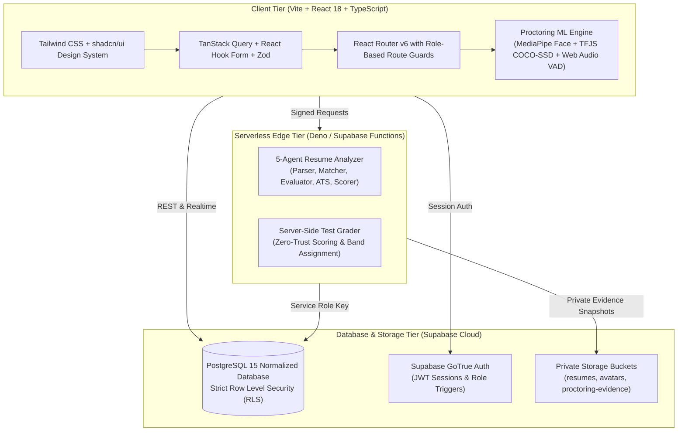

# Ready2Hire — Career-Readiness & Verified Hiring Platform

> **Final-Year B.Tech Computer Science & Engineering Capstone Project**  
> *Production-grade full-stack platform featuring a 5-agent resume alignment engine, server-graded skill assessments, and real-time in-browser proctoring.*

[](https://www.typescriptlang.org/)
[](https://vitejs.dev/)
[](https://react.dev/)
[](https://tailwindcss.com/)
[](https://supabase.com/)
[](https://vitest.dev/)

---

## 1. System Architecture



---

## 2. Key Capabilities by Role

### 👨‍🎓 Applicant (Student)
- **Job Discovery & Naukri-Style Search:** Filter by experience, salary range (LPA), work mode (Remote/Hybrid/Onsite), industry, and skills with deep URL state synchronization.
- **5-Agent Resume Analyzer:** Deterministic parsing, keyword alignment, ATS scoring, and prioritized recommendations against real job descriptions.
- **AI-Proctored Skill Assessments:** In-browser verification with full-screen lock, iris/gaze tracking, multi-face alerts, peripheral device detection, and auto-submit triggers.
- **Application Pipeline Tracker:** Step-by-step visual status timeline (`Applied` → `Under Review` → `Shortlisted` → `Test Assigned` → `Interview` → `Offer`).
- **Profile & Resume Builder:** Profile-strength indicator, skills taxonomy manager, and 1-click standardized PDF export.

### 💼 Recruiter (Employer)
- **Verified Candidate Pipeline:** Dense Greenhouse/Linear-style dashboard displaying candidate match %, resume ATS score, verified test grade, and proctoring risk score.
- **Candidate Comparison:** Compare 2 to 3 shortlisted candidates side-by-side across topic breakdowns and integrity standing.
- **Proctoring Audit Console:** Inspect chronological violation logs, webcam snapshots, face tracking metrics, and record auditor decisions (`Verified Clean`, `Conditional`, `Flagged`).
- **Job Management:** Post, edit, filter, and export applications to CSV.

### 🛡️ Institutional Admin
- **Placement Cell Master Console:** System-wide metrics (grade distributions, enrollment numbers, proctoring risk indices).
- **User Management:** Suspend/reactivate accounts and modify user permissions.
- **Proctoring Configuration:** Adjust maximum allowable warnings, risk termination thresholds, and retake cooldown intervals.

---

## 3. Technology Stack & Technical Rationale

| Layer | Technology | Engineering Rationale |
| :--- | :--- | :--- |
| **Frontend Framework** | React 18 + Vite | Sub-second HMR, concurrent rendering, and small production bundle footprints (`gzip < 90KB`). |
| **Language** | TypeScript (Strict) | Compile-time correctness, strict null safety, and zero `any` leakage across API models. |
| **Design System** | Tailwind CSS + Radix UI (shadcn) | Accessible WCAG AA tokens, headless Radix primitives, restrained typography, and dark mode support. |
| **Data Fetching** | TanStack Query v5 | Automatic background refetching, request deduplication, and cache invalidation. |
| **Backend & Database** | Supabase Postgres 15 | Native Row Level Security (RLS), ACID transactions, and automated `on_auth_user_created` trigger. |
| **Server Logic** | Supabase Edge Functions (Deno) | Zero-trust server-side test grading and secure 5-agent resume orchestration. |
| **Client-side ML** | MediaPipe + TFJS COCO-SSD | In-browser face landmarker and peripheral object detection without uploading video feeds to servers. |
| **Audio Processing** | Web Audio API | Analyzes voice activity levels (VAD) and continuous noise peaks with zero acoustic storage. |
| **Testing** | Vitest + Playwright | High-speed unit tests for grading and risk logic; E2E browser verification. |

---

## 4. Quickstart: Running Locally

### Step 1: Install Dependencies
```bash
npm install
```

### Step 2: Start Development Server
```bash
npm run dev
```
Navigate to `http://localhost:5173` in your browser.

### Step 3: Run Unit Tests
```bash
npm test
```
Runs 10 passing unit tests for the 5-Agent pipeline and Proctoring Engine.

### Step 4: Production Build
```bash
npm run build
```
Generates the optimized production build in `dist/`.

---

## 5. Live Demo Credentials

Ready2Hire includes a **Demo Showcase Bar** docked at the top of the app allowing 1-click switching between all three roles without typing credentials. Alternatively, manual credentials:

| Role | Email | Password | Primary Workflow |
| :--- | :--- | :--- | :--- |
| **Student** | `aravind.k@college.edu` | `Password@123` | Take proctored tests, run resume analyzer, track applications. |
| **Recruiter** | `priya.nair@razorpay.com` | `Password@123` | Review pipeline, inspect proctoring reports, compare candidates. |
| **Admin** | `admin@ready2hire.com` | `Admin@123456` | Adjust proctoring thresholds, review system KPIs, moderate users. |

---

## 6. Supabase Cloud Configuration Guide

Follow these numbered steps to connect Ready2Hire to your live Supabase cloud backend:

### 1. Create a Supabase Project
Log in to [database.new](https://database.new) and create a project named `ready2hire`.

### 2. Configure Local `.env`
Update `.env` with your Project URL, anon key, and service role key:
```env
VITE_SUPABASE_URL=https://<your-project-id>.supabase.co
VITE_SUPABASE_ANON_KEY=eyJhbGciOiJIUzI1NiIsInR5cCI...
SUPABASE_SERVICE_ROLE_KEY=eyJhbGciOiJIUzI1NiIsInR5cCI...
```

### 3. Supabase CLI: Link & Apply Migrations
```bash
# Authenticate CLI
npx supabase login

# Link your remote project
npx supabase link --project-ref <your-project-id>

# Push the schema, triggers, and RLS policies
npx supabase db push
```

### 4. Supabase Dashboard Authentication Settings
1. Navigate to **Authentication** → **Providers** → **Email**.
2. **Disable "Confirm email"** (Crucial for live capstone demoing to avoid Supabase's default email rate limits).
3. Under **URL Configuration**, set Site URL to `http://localhost:5173` and add Redirect URLs: `http://localhost:5173/**`.

### 5. Deploy Edge Functions & Secrets
```bash
# Set secrets
npx supabase secrets set SUPABASE_SERVICE_ROLE_KEY=<your-service-role-key>

# Deploy functions
npx supabase functions deploy resume-analyzer
npx supabase functions deploy grade-test
```

### 6. Populate Sample Seed Data
```bash
npm run seed
```

---

## 7. Deep Dive: Core Algorithms & Methodologies

### A. The 5-Agent Resume Matcher
The analyzer executes five sequential modules:
1. **Parser Agent:** Extracts contact metadata, educational credentials, technology taxonomies, and projects.
2. **Skills Matcher Agent:** Performs exact keyword matching and canonical synonym normalization (e.g. `k8s` → `kubernetes`, `golang` → `go`), computing coverage ratio.
3. **Experience & Education Evaluator:** Evaluates tenure length, STEM degree fit, and presence of quantifiable metrics in project bullet points.
4. **ATS & Format Checker:** Scans for standard section headings, document length, readability indices, and parsing hazards.
5. **Final Scorer Agent:** Aggregates outputs using the weighted formula:
   $$\text{Overall Score} = (\text{Parser} \times 0.10) + (\text{Skills} \times 0.45) + (\text{Experience} \times 0.25) + (\text{ATS} \times 0.20)$$

### B. Server-Side Skill Test Grading
- Grading is executed server-side in Edge Functions to ensure zero client-side tampering.
- Answers are verified against official answer keys in the database.
- **Grade Bands:**
  - `A+`: $\ge 90\%$ (Advanced Mastery)
  - `A`: $80\% - 89\%$ (Proficient)
  - `B`: $70\% - 79\%$ (Competent)
  - `C`: $60\% - 69\%$ (Foundational)
  - `F`: $< 60\%$ (Needs Retake)

### C. In-Browser AI Proctoring Engine
The engine processes client-side telemetry in a throttled loop (every 600ms) to ensure smooth performance on standard laptops:
- **Face Mesh (MediaPipe):** Monitors face presence and iris vector angle. Flags `NO_FACE` if sustained $> 3$ seconds, `MULTIPLE_FACES`, and `LOOKING_AWAY`.
- **Object Detection (COCO-SSD):** Scans for unauthorized peripherals (cell phones, secondary monitors, textbooks).
- **Web Audio VAD:** Measures acoustic peaks above threshold without streaming raw audio to external servers.
- **Browser Integrity:** Detects `visibilitychange`, `window.blur`, `fullscreenchange`, DevTools shortcuts (`F12`, `Ctrl+Shift+I`), copy/paste attempts, and screen sharing disconnections.
- **Risk Score Formula:**
  $$\text{Risk Score} = \min\left(100, \sum (W_{\text{critical}} \times 30 + W_{\text{high}} \times 15 + W_{\text{med}} \times 6 + W_{\text{low}} \times 2)\right)$$
- **Escalating Warnings:** Warnings 1 and 2 notify the candidate. A 3rd violation or risk $\ge 80$ terminates the session.
- **Honest Limitations & Privacy Design:** In-browser proctoring serves as a deterrent and transparent evidence trail. It is advisory for human recruiters and does not constitute an automated legal accusation.

---

## 8. Five-Minute Capstone Demo Script

1. **Minute 1: Introduction & Landing Page (Guest Mode)**
   - Open `http://localhost:5173`.
   - Point out the clean Linear/Greenhouse style, lack of generic AI fluff, and the dual-sided value proposition.
2. **Minute 2: Student Experience — 5-Agent Resume Matcher**
   - Click "Student" on the top Demo Showcase bar.
   - Navigate to `/resume-analyzer`.
   - Click "Backend SDE" preset and click "Execute 5-Agent Pipeline".
   - Walk through the Score Gauge (92%), matched vs missing skills, and the tabbed breakdown showing each agent's execution.
3. **Minute 3: Standardized AI-Proctored Test**
   - Navigate to `/tests` and launch "Data Structures & Algorithms".
   - Demonstrate the 4-step pre-test checklist: Consent notice → Camera/Mic test with live audio meter → Screen share verification (monitor check) → Fullscreen lock.
   - In the test workspace, demonstrate the autosave, timer, question navigator, and trigger a simulated violation (e.g. exit fullscreen or right click) to show the warning toast.
   - Click "Finish & Submit" to view the celebratory results screen with grade band and verified badge.
4. **Minute 4: Recruiter Dashboard & Pipeline**
   - Switch role to "Recruiter" via the top bar.
   - Review the candidate pipeline table showing Aravind Kumar with 94% match, Grade A+ in DSA, and 8.5/100 risk.
   - Select 2 candidates and click "Compare Selected" to demonstrate the side-by-side comparison modal.
   - Click the Proctoring Risk badge to open the Proctoring Audit Report showing chronological timestamps and auditor decision toggles.
5. **Minute 5: Admin Operations & Architecture Viva**
   - Switch role to "Admin".
   - Highlight the Recharts grade distribution, recruiter verification queue, and proctoring threshold sliders.
   - Open `/setup-guide` to explain Supabase RLS and Edge Function deployment.

---

## 9. Viva-Voce Questions & Strong Architecture Answers

**Q1: How do you prevent a student from tampering with test scores or fabricating answers?**  
*Answer:* The client never calculates the final grade. Only selected answer IDs and time spent are transmitted over HTTPS to the `grade-test` Supabase Edge Function. The Edge Function uses a private `SUPABASE_SERVICE_ROLE_KEY` to cross-reference the canonical answer keys in Postgres, compute the percentage, update the attempt row, and enforce RLS policies preventing student write-access to test results.

**Q2: What is the architectural justification for a 5-agent pipeline instead of a single LLM prompt?**  
*Answer:* Single LLM prompts suffer from non-deterministic outputs, hallucinated scoring scales, and latency costs. Our 5-agent architecture decouples concerns into deterministic modules: parsing, keyword extraction, experience evaluation, and ATS rule checks. This enables predictable, reproducible scores ($0-100$), zero token cost for rule-based evaluation, and explainable audit breakdowns.

**Q3: How does your proctoring system preserve candidate privacy?**  
*Answer:* Continuous raw webcam and microphone streams are never uploaded or stored on servers. All inference runs in the browser via Web Workers and WebAssembly. Only short, timestamped low-resolution evidence frames are uploaded to a private Supabase Storage bucket when a threshold violation occurs.

**Q4: How is Row-Level Security (RLS) configured across roles?**  
*Answer:* Every table has RLS enabled. Profiles are only editable by their owner. Candidates can only see their own applications and resumes. Recruiters can only access candidates who explicitly applied to their jobs or consented to share test results. Admins have access to the full institutional catalog via the `is_admin()` security definer function.
